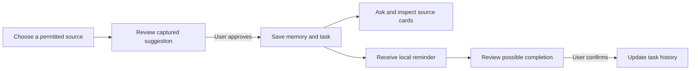

# Retenqo — Offline AI Memory and Commitment Assistant for Android

**Important messages shouldn’t become forgotten commitments.** Retenqo helps you capture selected phone context, review commitments, ask about saved details with on-device AI, and follow through with reminders you control. Personal memory stays on your Android device; notification capture is opt-in, and the language model is a separate optional download.

[Synthetic browser walkthrough source](web/src/pages/demo.astro) · [Problem-statement alignment matrix](docs/EVALUATION_ALIGNMENT.md) · [Download Android APK](https://github.com/priyanshuchawda/retenqo/releases/latest) · [Website](https://retenqo.pages.dev) · [Source](https://github.com/priyanshuchawda/retenqo) · [Evaluation evidence](docs/EVALUATION_GUIDE.md)

## The Problem We Solve

### Our Open Innovation Problem Statement

Everyday digital context is fragmented across notifications, messages, images and documents. People lose time reconstructing important information, miss commitments buried in conversations and struggle to follow through. Existing search and task tools often require manual organization, while cloud-based AI may expose sensitive personal context or require connectivity.

**Retenqo-defined Open Innovation challenge:** Build a privacy-first, mobile personal-intelligence system that turns user-authorized context into structured, retrievable memories and reviewable commitments; supports evidence-linked recall and timely follow-through; and uses resource-aware on-device processing while preserving user consent and decision authority.

This is Retenqo’s self-defined problem statement, not an organizer quotation. The Hack2Skill submission’s selected challenge and commit still need owner-side confirmation; no official challenge score is claimed.

## How Retenqo Solves It

| Problem | What the user does | Production code | Test evidence |
| --- | --- | --- | --- |
| Requests disappear in notifications | Enable selected sources, then review a captured suggestion and its source | [Notification listener](android/mneme/app/src/main/java/com/mneme/app/notif/MnemeNotificationListener.kt), [capture settings](android/mneme/app/src/main/java/com/mneme/app/notif/NotificationCaptureSettings.kt), [pipeline](android/mneme/app/src/main/java/com/mneme/app/pulse/PulsePipeline.kt) | [Consent tests](android/mneme/app/src/test/java/com/mneme/app/notif/NotificationConsentQueueTest.kt), [queue tests](android/mneme/app/src/test/java/com/mneme/app/notif/NotifTextTriageTest.kt) |
| Old details are hard to find | Ask a question and inspect the returned memory cards | [Memory repository](android/mneme/app/src/main/java/com/mneme/app/data/NoteRepository.kt), [Ask](android/mneme/app/src/main/java/com/mneme/app/ai/MemoryAsk.kt), [answer guard](android/mneme/app/src/main/java/com/mneme/app/ai/AskAnswerGuard.kt) | [Retrieval tests](android/mneme/app/src/test/java/com/mneme/app/data/MemoryLexicalSearchTest.kt), [grounding tests](android/mneme/app/src/test/java/com/mneme/app/ai/AskAnswerGuardTest.kt) |
| Commitments are easy to miss | Confirm a reminder and decide whether later evidence completes the task | [Due dates](android/mneme/app/src/main/java/com/mneme/app/ai/DueDateGuess.kt), [reminders](android/mneme/app/src/main/java/com/mneme/app/remind/DueReminderScheduler.kt), [completion matcher](android/mneme/app/src/main/java/com/mneme/app/data/FollowThroughMatcher.kt) | [Date tests](android/mneme/app/src/test/java/com/mneme/app/ai/DueDateGuessTest.kt), [completion tests](android/mneme/app/src/test/java/com/mneme/app/data/FollowThroughMatcherTest.kt), [reminder tests](android/mneme/app/src/test/java/com/mneme/app/remind/DueDigestTest.kt) |

## See the Workflow



The [browser walkthrough](web/src/pages/demo.astro) is an interactive synthetic illustration. It does not run Android notification capture, change app data, or execute local model inference. For the native app scenario and manual setup, see [Demo walkthrough](docs/DEMO_WALKTHROUGH.md).

## Core Features

1. **Smart Capture & Commitment Detection** — choose supported notification sources, review extracted commitments before saving, and retain source context.
2. **Offline AI Memory & Recall** — search saved cards and ask questions with local retrieval; answers can cite relevant source cards. Exact factual claims are checked conservatively, but citations alone do not guarantee every answer is correct.
3. **Smart Reminders & Completion Tracking** — review due dates, schedule local reminders, and confirm any proposed completion before task history changes.

Additional capabilities include selected image/document OCR, voice notes, screen-context capture when separately enabled, and encrypted backup exports. See [permissions](web/src/pages/permissions.astro), [model setup](docs/OFFLINE_MODELS.md), and [backup/security boundaries](docs/THREAT_MODEL.md).

## Why On-Device AI?

Retenqo uses rules-first processing and the optional Qwen3.5-0.8B Q4_0 GGUF model through llama.cpp. The model is a separate **563,036,064-byte** download and is not included in the APK. Personal memory inference does not require a cloud AI endpoint. Room data is stored with SQLCipher and a Keystore-protected key; backup exports use password-derived authenticated encryption. App-private notification queue preferences are not application-encrypted. See the [threat model](docs/THREAT_MODEL.md).

## Download and Run

The latest stable release recorded here is [Retenqo v0.1.4](https://github.com/priyanshuchawda/retenqo/releases/tag/v0.1.4), version code 5, for **Android 13+ (API 33+) on ARM64**. The [APK](https://github.com/priyanshuchawda/retenqo/releases/download/v0.1.4/Retenqo-v0.1.4-arm64-v8a.apk) is 39,374,307 bytes. Its published SHA-256 is `b31770666bf7b860e9dc3e562a97de7286c6ad31347f67a1ce8fa96fdabf8f98`; the pinned signer certificate SHA-256 is `b975fe4b5d929586e9bf0133ebde25c03d0acf990ddbba5c14f0f2b31ae38cca`. The release was verified as an in-place upgrade on Android 16, API 36. Current source fixes in this branch are not part of that already-published APK.

Install only from the verified GitHub release and keep Android's security protections enabled. During setup, grant only the notification and optional screen/media/microphone permissions you choose; notification groups start paused. The [installation guide](https://retenqo.pages.dev/installation) explains setup and the [download page](https://retenqo.pages.dev/download) shows release provenance.

To build from source, use Git, Bash, JDK 21, Android SDK platform 36, NDK 28.2.13676358 and CMake 4.1.2:

```bash
git clone https://github.com/priyanshuchawda/retenqo.git
cd retenqo
bash scripts/build-mneme.sh
```

## Engineering Quality

| Evaluation area | Evidence to inspect |
| --- | --- |
| Problem alignment | [Clause → user action → code → test → demo → observed result](docs/EVALUATION_ALIGNMENT.md), [self-defined requirements](docs/PRODUCT_REQUIREMENTS.md), [native walkthrough](docs/DEMO_WALKTHROUGH.md) |
| Code quality | [Architecture](docs/ARCHITECTURE.md), [domain models](android/mneme/app/src/main/java/com/mneme/app/data/CardModels.kt), [website validation](web/src/lib/releases/validation.ts) |
| Security | [SQLCipher database](android/mneme/app/src/main/java/com/mneme/app/data/MnemeDatabase.kt), [security review](docs/SECURITY_REVIEW.md), [threat model](docs/THREAT_MODEL.md) |
| Efficiency | [Power gates](android/mneme/app/src/main/java/com/mneme/app/media/MnemePowerGates.kt), [performance record](docs/PERFORMANCE.md) |
| Testing | [Android unit tests](android/mneme/app/src/test/), [device tests](android/mneme/app/src/androidTest/), [website tests](web/tests/) |
| Accessibility | [Android accessibility evidence](docs/ACCESSIBILITY.md), [website accessibility](web/docs/ACCESSIBILITY.md) |

## Test and Reproduce

From `android/mneme/` after `bash scripts/bootstrap-native-deps.sh`:

```bash
bash ./gradlew :app:testDebugUnitTest :app:lintDebug :app:assembleDebug :app:assembleDebugAndroidTest --no-daemon --max-workers=2
bash ./gradlew :app:connectedDebugAndroidTest --no-daemon --max-workers=2
```

From `web/`, use the pinned lockfile and CI-approved esbuild install script:

```bash
pnpm install --frozen-lockfile --allow-build esbuild
pnpm lint && pnpm typecheck && pnpm test && pnpm build && pnpm test:e2e
```

Recorded historical totals are revision-scoped: 114 Android JVM tests, 6 device instrumentation tests on API 36, 25 website unit tests, and a browser run with 98 passes, 68 documented skips and 2 retry passes. Fresh runs for this branch are recorded in [Testing](docs/TESTING.md); website coverage does not represent Android coverage. The hackathon evaluator scores are **unmeasured for this branch**.

## Documentation

[Evaluation guide](docs/EVALUATION_GUIDE.md) · [Requirements traceability](docs/REQUIREMENTS_TRACEABILITY.md) · [Testing](docs/TESTING.md) · [Security review](docs/SECURITY_REVIEW.md) · [Performance](docs/PERFORMANCE.md) · [Accessibility](docs/ACCESSIBILITY.md) · [Implementation status](docs/IMPLEMENTATION_STATUS.md) · [Release process](docs/RELEASE_PROCESS.md) · [Contributing](CONTRIBUTING.md) · [Third-party notices](docs/THIRD_PARTY_NOTICES.md) · [Apache 2.0 license](LICENSE)
